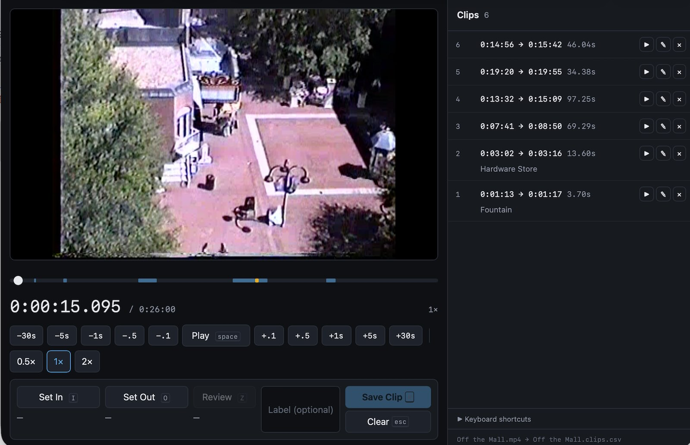

# Cutty Sark

Mark clips—by start time, end time, an optional label, and their caption text—within a
single long video file, appending each one to a CSV as you go.

It's a local web UI served by a small Python script. The browser plays and scrubs the
video; the Python process owns the file on disk (which browsers can't do).

No dependencies, no build step. Just Python 3 and the two files in this repo.

_Please note that 99% of this was created by Claude._ It’s in my repo, but it feels weird
to call this something "I" "made."



## Usage

```
python3 clipper.py /path/to/movie.mp4
```

That starts a server on `127.0.0.1`, prints the URL, and opens your browser. Ctrl-C
stops it. Clips are written to `movie.clips.csv` next to the video.

Options:

| Flag | Meaning |
|---|---|
| `--csv PATH` | Write clips somewhere other than `<name>.clips.csv` |
| `--captions PATH` | Use a specific caption file |
| `--port N` | Bind a specific port (default: a free one) |
| `--no-browser` | Don't open a browser |

If a `.vtt` or `.srt` file sits beside the video (`movie.vtt`, `movie.en.srt`), it's
picked up automatically and can be toggled with `C`. SRT is converted to WebVTT on the
fly.

## Caption text

Each clip carries the text spoken during it. When a caption file is available, setting
in and out points fills the captions box below the label with the text of every cue that
overlaps the clip—markup stripped, and lines repeated by "rolling" captions (YouTube's
auto-captions, for instance) dropped. Edit it freely: once you've typed in the box it
stops following the in/out points, and **↻ From captions** puts the extracted text
back.

Saved clips can be edited with ✎ in the clip list, which opens their label and captions
in place. Without a caption file the box is still there; it's just empty until you type.

## Keyboard

The keyboard is the real interface—marking dozens of clips means hands stay put.

| Key | Action |
|---|---|
| `Space` | Play / pause |
| `←` / `→` | Nudge 1s |
| `Shift` + `←` / `→` | Nudge 0.1s |
| `,` / `.` | Nudge 1s |
| `J` / `L` | Nudge 5s |
| `I` | Set in point at current time |
| `O` | Set out point at current time |
| `Z` | Review the pending clip: plays from the in point and stops at the out point (with no out point set, just plays from the in point) |
| `C` | Toggle captions |
| `Enter` | Save clip (from anywhere, including the label and captions boxes) |
| `Shift` + `Enter` | New line in the captions box |
| `Tab` | Jump to the label field, then toggle between label and captions |
| `Esc` | Clear the pending in/out |

## Output

```csv
start,end,duration,label,captions
92.400,101.200,8.800,Opening line,"Good evening, and welcome."
254.000,258.500,4.500,,
```

Seconds as decimals, which sort numerically and drop straight into
`ffmpeg -ss <start> -to <end>`. `duration` is derived, for eyeballing. Rows are in the
order you marked them, not sorted by time—the file is a log of what you did. Captions are
a single line as extracted; any line breaks you add by hand are kept, inside a quoted
field.

Reopening against an existing CSV loads it and appends. A CSV from before the `captions`
column existed loads fine; its clips get empty captions, which you can fill in with ✎.
Each launch first copies the
existing CSV to `.csv.bak`, so the backup holds the file as it was at the start of the
current session (not the very first version).

## Not losing clips

Each clip is a separate request that returns only once the file write has landed. The
server holds the authoritative list and rewrites the whole CSV to a temp file, then
`os.replace()`s it into place—atomic, so an interrupted write can't truncate anything.
A failed save leaves the clip on screen rather than silently dropping it.

Pending (unsaved) in/out points, label, and captions are kept in the browser's `localStorage`, so
they survive a page reload or an accidentally closed tab. They do *not* survive
restarting `clipper.py`: each run picks a new port by default, and browsers keep
`localStorage` separately per port. With a fixed `--port` they do carry over—but they
aren't tied to a particular video, so they'll reappear against whatever video you open
next. Saved clips are unaffected by any of this; they live in the CSV.

## If the video won't play

Browsers won't decode everything (MKV, ProRes, some AV1). Clipper notices and prints an
`ffmpeg` command for a browser-friendly proxy:

```
ffmpeg -i movie.mkv -c:v libx264 -crf 23 -preset veryfast -c:a aac proxy.mp4
```

Timings marked against the proxy are valid for the original — the transcode preserves
timestamps.

## Files

```
clipper.py       # server: static files, video streaming with Range support, CSV
clipper.html     # the entire UI, inline
test_clipper.py  # unit tests: python3 -m unittest
```

## License

MIT. See [LICENSE](LICENSE).
